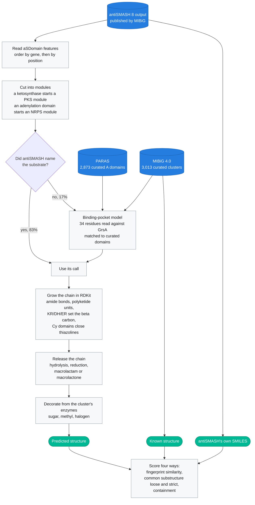

# SeMPI-3

Predict the chemical structure of a secondary metabolite from the composition
and order of the genes in its biosynthetic gene cluster (BGC).

SeMPI-3 reads an **antiSMASH** annotation, cuts the assembly line into modules,
and builds the product backbone atom by atom with **RDKit**. Predictions are
benchmarked against the curated structures in **MIBiG 4.0**, with antiSMASH's
own structure prediction as the baseline to beat.

Scope: modular type-I **PKS**, **NRPS** and PKS/NRPS hybrids — the systems whose
product can be read off the domain order.

On the MIBiG benchmark, given the same antiSMASH input, SeMPI-3's structures
are closer to the real product than antiSMASH's own prediction on 864 of
1,161 clusters.

> Status: early but usable. `sempi3 run` works on any antiSMASH GenBank file.
> The chemistry and the benchmark are solid; the substrate model is a
> nearest-pocket matcher rather than something learned. See [Roadmap](#roadmap).

## Install

```bash
conda env create -f environment.yml
conda activate sempi3
pip install -e .
```

antiSMASH is **not** a dependency. SeMPI-3 reads antiSMASH *output*, and MIBiG
publishes that output for every entry, so nothing has to be installed or run.

## Data

```bash
./scripts/fetch_data.sh      # ~95 MB download, ~400 MB on disk
```

| File | Size | What it gives |
|---|---|---|
| `mibig_json_4.0.tar.gz` | 30 MB | curated clusters: compounds with SMILES, curated modules |
| `mibig_antismash_4.0_gbk_as8b1.tar.bz2` | 64 MB | antiSMASH 8 output per entry: domains, substrates, baseline SMILES |
| PARAS database files | 300 kB | 3,653 curated A-domain substrates with binding-pocket signatures ([PARAS](https://github.com/BTheDragonMaster/parasect), CC BY 4.0) |

Optional, and fetched by hand because the publisher blocks automated requests:
`A_domains.csv` from the [SeMPI 2.0 supplement](https://www.mdpi.com/2218-1989/11/1/13/s1)
(Zierep et al., *Metabolites* 2020, CC BY). It lists 2,868 A domains, 1,546 of
them from Prieto et al. and keyed by UniProt accession rather than by cluster.
Put it in `data/external/sempi2/` and run:

```bash
python scripts/build_prieto_dataset.py --csv data/external/sempi2/A_domains.csv
```

That fetches the proteins from UniProt, locates each adenylation domain by
aligning the reference domain along the protein, and writes binding-pocket
signatures that `scripts/experiment_substrates.py` can train on.

Of 3,013 MIBiG entries, **1,457** are PKS/NRPS with both a known structure and
an antiSMASH annotation. That is the benchmark set.

## Use

**Downstream of antiSMASH, on any genome.** Run antiSMASH, then point SeMPI-3
at the GenBank file it wrote:

```bash
sempi3 run region001.gbk                  # structure, modules, antiSMASH's own call
sempi3 run region001.gbk --format smiles  # just the SMILES, for a pipeline
sempi3 run region001.gbk --format json --out prediction.json
sempi3 run region001.gbk --no-tailoring   # the bare backbone
```

```text
BGC0000290  products=NRPS|T3PKS  modules=7
   0 nrps Dhpg
   1 nrps Tyr                       E
   ...
tailoring enzymes: {'halogenase': 2, 'hydroxylase': 4}
release: macrolactam
SeMPI-3:   O=C1N[C@@H](c2ccc(O)cc2Cl)C(=O)N[C@@H](c2cc(O)cc(O)c2)...
antiSMASH: NC(c1ccc(O)cc1)C(=O)NC(Cc1ccc(O)cc1)C(=O)NC(c1cc(O)cc(O)c1)...
```

A genome-wide antiSMASH run puts many regions in one file; each is treated as
its own assembly line and gets its own row. `--format tabular` is the one to
use in a workflow:

```text
region              products  modules  substrates_predicted  release       smiles          antismash_smiles
contig1_region3     NRPS      7        2                     macrolactam   O=C1N[C@@H]...  NC(c1ccc(O)...
```

No extra files are needed: the binding-pocket reference that names the
substrates antiSMASH leaves unnamed ships inside the package (162 kB).

### Keeping it current

The reference is a derived file, not a trained model, so a new release of
MIBiG is absorbed by fetching it and rebuilding:

```bash
./scripts/fetch_data.sh                 # point it at the new release
sempi3 build-reference                  # rewrites sempi3/data/substrate_signatures.tsv
pytest -q && sempi3 benchmark           # check nothing regressed
```

`build-reference` takes `--json-dir`, `--antismash-dir` and `--paras`, so any
collection of curated domains can be folded in. Today's table holds 3,980
signatures from 2,575 MIBiG domains and 3,653 PARAS rows.

A note on where the pocket positions came from: they were recovered from the
PARAS data by alignment rather than copied from a paper, and PARAS later
turned out to publish its own per-domain positions. Ours reproduce their
signatures residue for residue 91.5% of the time, against 80.1% for the
obvious alternative numbering, so the recovery was sound.

**Working against MIBiG**, for development and benchmarking:

```bash
sempi3 predict BGC0000290              # predict one MIBiG cluster
sempi3 predict BGC0000290 --show-variants
sempi3 spec BGC0000001                 # the parsed assembly line, as JSON
sempi3 benchmark --workers 8           # score every arm over MIBiG
```

## How it works



The numbered walk-through:

1. **Parse** (`antismash_io.py`) — read `aSDomain` features from the antiSMASH
   GenBank, order them by gene and position in the protein, and cut them into
   modules: a new PKS module at every ketosynthase, a new NRPS module at every
   adenylation domain. Substrates come from the `substrate consensus` qualifier.
2. **Assemble** (`assembly.py`, `chem.py`) — grow the chain as a real molecule:
   - NRPS modules form an amide bond with their amino acid;
   - heterocyclisation (Cy) domains close the residue into a thiazoline
     (cysteine) or oxazoline (serine, threonine) ring;
   - PKS modules add a two-carbon unit, and the module's KR/DH/ER domains set
     the oxidation level of the beta carbon (keto → hydroxyl → ene → alkyl);
   - epimerase domains invert the alpha carbon, methyltransferases add a methyl;
   - the chain is released by hydrolysis, reduction, macrolactamisation or
     macrolactonisation.
   Tailoring enzymes found in the cluster then decorate the backbone
   (`tailoring.py`): a sugar, a halogen or a methyl group, one each at most.
3. **Fill the gaps** (`stachelhaus.py`, `substrates.py`) — antiSMASH reports
   no substrate for about one adenylation domain in six. Those domains are
   given one by reading their binding-pocket residues and matching them
   against curated domains from MIBiG and PARAS. antiSMASH's own calls are
   never overridden.
4. **Compare** (`compare.py`) — score the prediction against the known
   structure four ways, because no single number says whether a backbone is
   right:

   | Measure | What it answers |
   |---|---|
   | `tanimoto` | Morgan-fingerprint similarity to the whole product |
   | `coverage_pred` | share of the prediction found in the product, bond orders ignored |
   | `strict_coverage_pred` | the same with bond orders required to agree |
   | `substructure` | is the prediction literally contained in the product |

   The strict measure exists because the loose one is blind to exactly the
   differences an assembly line decides. A saturated chain scored against an
   unsaturated one gives a loose coverage of 1.00 and a strict coverage of
   0.75; Tanimoto meanwhile falls from 1.0 to 0.375, which overstates a
   one-bond difference. Reading all four together is more honest than
   trusting any one of them.

The result is a **backbone**. Post-assembly tailoring — glycosylation,
halogenation, oxidative crosslinking, prenylation — is not modelled, so a
prediction is deliberately smaller than the finished natural product. The
`coverage_pred` metric is the one that should be high for a backbone
predictor: it asks whether everything predicted is really present in the
product.

## Evaluation design

Three arms are scored against the same ground truth, one row per cluster in
`results/benchmark.csv`:

| Arm | Input | What it measures |
|---|---|---|
| `antismash` | — | antiSMASH's own prediction: the baseline |
| `sempi3_antismash` | antiSMASH domains | **the fair comparison**: same information, different rules |
| `sempi3_mibig` | MIBiG curated modules | upper bound on the assembly chemistry |

Two caveats, stated plainly:

- **`sempi3_mibig` is not de-novo prediction.** MIBiG's curated substrates are
  partly inferred from the known structure, so that arm leaks information. It
  is reported to separate "the assembly rules are wrong" from "the substrate
  predictions are wrong", not as a headline number.
- **Every arm commits to one structure per cluster.** SeMPI-3 picks its release
  mechanism from the domains (`assembly.choose_release`) rather than reporting
  whichever variant happens to score best. The `sempi3_antismash_oracle` arm
  *does* take the best variant, and is reported only as an upper bound: it
  measures what perfect release prediction would be worth (+0.034 mean
  Tanimoto). A cluster often makes several congeners, so the best-matching
  compound is still taken for every arm alike; the chosen compound is recorded
  in the results table.

## Results

Benchmark over the MIBiG 4.0 PKS/NRPS set. Numbers are regenerated by
`sempi3 benchmark`; the table below is filled in from `results/benchmark.summary.json`.


<!-- RESULTS:START -->
Benchmark set: **1628 clusters** (MIBiG 4.0 PKS/NRPS entries with a known structure).

| Arm | Predicted | Tanimoto mean | Tanimoto median | ≥0.4 | ≥0.6 | Coverage of prediction |
|---|---|---|---|---|---|---|
| antiSMASH (baseline) | 1218 | 0.146 | 0.111 | 56 | 14 | 0.425 |
| SeMPI-3 from antiSMASH | 1341 | 0.195 | 0.150 | 127 | 40 | 0.502 |
| SeMPI-3 from MIBiG modules | 528 | 0.276 | 0.205 | 122 | 41 | 0.578 |

**Head to head against antiSMASH**, on clusters where both made a prediction:

| Arm | Compared | Wins | Ties | Losses | Mean Tanimoto difference |
|---|---|---|---|---|---|
| SeMPI-3 from antiSMASH | 1161 | 862 | 7 | 292 | +0.061 |
| SeMPI-3 from MIBiG modules | 490 | 360 | 5 | 125 | +0.098 |

**Mean Tanimoto by cluster class:**

| Class | Clusters | antiSMASH | SeMPI-3 (antiSMASH input) | SeMPI-3 (MIBiG modules) |
|---|---|---|---|---|
| NRPS_only | 469 | 0.219 | 0.302 | 0.372 |
| PKS_only | 677 | 0.091 | 0.128 | 0.132 |
| hybrid | 375 | 0.136 | 0.203 | 0.231 |

Tanimoto is low for every arm in absolute terms, which is expected: all three predict a *backbone*, while the reference is the finished, tailored natural product. The comparison between arms is the meaningful part.
<!-- RESULTS:END -->

## What was tried, and what it was worth

Every change was measured on the full benchmark before being kept. Mean
Tanimoto of the committed prediction, in the order the work happened:

| Step | Mean | Kept |
|---|---|---|
| Backbone from antiSMASH domains | 0.187 | — |
| \+ substrate prediction for unassigned A domains | 0.192 | yes |
| \+ heterocyclisation from Cy domains | 0.192 | yes |
| \+ tailoring (sugar, methyl, halogen) | **0.195** | yes |
| Release mechanism from a structure-trained model | 0.186 | **no** |
| Release mechanism from a best-variant model | 0.189 | **no** |
| \+ hydroxylation from P450 genes | 0.188 | **no** |

### Ring sizes, and what the gene layout gives away

Macrolactones were closing onto whichever hydroxyl sat nearest the acid, which
is the smallest ring the chain allows. Real ones are much larger:

| | median macrocycle | 10-90 percentile |
|---|---|---|
| MIBiG products | 17 | 12-29 |
| closing onto the nearest hydroxyl | 10 | 8-17 |
| **closing onto the furthest** | **18** | 9-32 |

Closing onto the furthest hydroxyl lifted the mean Tanimoto from 0.195 to
0.200 and the strict structure match from 0.434 to 0.460, and it succeeds more
often, since very small rings frequently failed to sanitise at all.

Whether a product is macrocyclic at all can be predicted from the cluster:
0.819 against 0.613 for always answering no. The informative features are the
expected ones — module count, thioesterase domains — but also how the genes
are laid out: genes per kilobase, the median gap between them, the share of
genes in an operon, and how often the strand changes. Using that prediction in
place of the domain rule cut the losses against antiSMASH from 320 to 279.

More broadly, a cluster says a good deal about its product without any
chemistry being built at all:

| Property | Score | Baseline | Typical error |
|---|---|---|---|
| amide count | R² 0.86 | — | 0.7 |
| nitrogen count | R² 0.84 | — | 1.0 |
| molecular weight | R² 0.73 | — | 126 Da of 655 |
| heavy atoms | R² 0.73 | — | 9 of 46 |
| ring count | R² 0.61 | — | 1.1 |
| carries a sugar | 0.85 | 0.72 | — |
| carries an aromatic ring | 0.82 | 0.59 | — |
| is macrocyclic | 0.82 | 0.61 | — |

### What actually limits the prediction

Taking our own module parse and replacing only the substrates with MIBiG's
curated ones, over the 474 clusters that have both:

| Assembly line | Mean Tanimoto |
|---|---|
| our modules, antiSMASH substrates | 0.251 |
| our modules, **curated substrates** | **0.282** |
| fully curated modules | 0.280 |

Correct substrates recover the whole gap: our reading of the assembly line is
already as good as the curation, and every remaining point is in *which
monomer each module selects*. That one result explains why so much else made
no difference, and it is where the work should go.

Four learned models were trained and then left out, because each improved the
chemistry without improving the structures:

| Model | Its own accuracy | Effect on structures |
|---|---|---|
| Release mechanism, trained on structures | 0.753 against the rule's 0.284 | 0.186, worse than 0.192 |
| Release mechanism, trained on best variant | 0.535 | 0.189, worse |
| Beta-carbon oxidation state | 0.73 against the rule's 0.62 | unchanged, with 23 of 40 structures altered |
| Which detected modules to skip | 0.777, below always-keep's 0.807 | unchanged |

The oxidation-state model was checked three ways in case the measure was
hiding its gain: against the whole product (0.2102 either way), against the
product with its sugars and halogens stripped off (0.2071 against 0.2069),
and against a strict maximum common substructure where bond orders have to
agree and an oxidation level therefore counts (0.4229 against 0.4212). It
gained nothing on any of them. One oxygen among sixty atoms does not move a
structure comparison, while the monomer a module picks moves several atoms at
once.

One caveat on that: modules are aligned to the curation by gene and by order
within the gene, which can mismatch where the two disagree about how many
modules a gene carries. That would blur both the training labels and where
the predictions land, so the result is evidence against the oxidation state
mattering much, not proof.

Two results are worth stating plainly because they are negative:

- **A better release model made the structures worse.** A random forest picks
  the real release mechanism far better than the domain rule (0.753 against
  0.284 accuracy), yet the predictions got worse. Closing a macrocycle raises
  fingerprint similarity even when the real product has no macrocycle, so the
  cruder rule suits the metric better. The rule is still in place, and both
  models are kept in `scripts/` rather than deleted.
- **Tailoring barely helps, and hydroxylation hurts.** The annotation says
  *which* enzyme a cluster encodes but never *where* it acts, so the site has
  to be guessed. Guessing costs more than it gains for hydroxyls.
- **Copying the nearest cluster is not prediction.** Encoding every cluster as
  a vector (`features.py`) and reporting the structure of its closest
  neighbour scores 0.323, which looks better than anything here — until
  neighbours above 0.9 similarity are excluded, when it falls to 0.161, below
  the assembled prediction. MIBiG holds near-duplicate clusters, and retrieval
  lives off them. For comparison, an assembled prediction sits 0.26 to 0.44
  away from the nearest known structure: it is built, not recalled.

### Substrate prediction

antiSMASH leaves about one adenylation domain in six without a call. Those
domains get one from their binding-pocket residues, matched against curated
domains from MIBiG and [PARAS](https://github.com/BTheDragonMaster/parasect).
Over 2,680 labelled domains, in folds grouped by cluster:

| Predictor | Accuracy |
|---|---|
| antiSMASH alone | 0.665 (no call for 415 domains) |
| Stachelhaus 9-residue code, MIBiG only | 0.590 |
| 34-residue signature, MIBiG only | 0.555 |
| 34-residue signature, MIBiG + PARAS | 0.606 |
| Random forest, MIBiG + PARAS | 0.638 |
| **antiSMASH, with the pocket model filling its gaps** | **0.715** |

The model does not beat antiSMASH on its own; it is worth having because it
answers where antiSMASH does not. Adding the PARAS data helped every variant
it was given to.

The binding-pocket positions were not copied from a paper: they were recovered
from the PARAS dataset by alignment, and the reference sequence shipped in
`sempi3/data/` reproduces the published `DAWTIAAIC` code for phenylalanine,
which is what pins the numbering.

## Roadmap

Ordered by what the measurements say is worth doing, not by what is
interesting to build:

1. **Better substrates, and nothing else first.** Correct monomers are worth
   +0.031 on their own, which is more than everything else tried put
   together. antiSMASH is right 78.6% of the time when it commits to a call,
   so the target is beating those calls rather than only filling the gaps our
   pocket model fills now.
2. **Extender units for polyketides.** MIBiG curates no acyltransferase
   substrates at all and antiSMASH offers little beyond malonyl and
   methylmalonyl, which is part of why PKS trails NRPS (0.128 against 0.302).
3. **Where tailoring acts**, rather than only which enzymes are present.
4. **A generative block model worth the name.** `blocks.py` already defines
   the token language and guarantees that any sequence assembles; what is
   missing is a sequence model trained on honest splits, which wants a GPU
   and more data than MIBiG alone provides.

## Development

```bash
pytest -q                                  # unit tests, no data needed
ruff check sempi3 tests && black --check sempi3 tests
```

Tests cover the chemistry primitives against independently written reference
SMILES and CIP codes, the assembly rules, and both parsers.

## Background

SeMPI-3 follows [SeMPI](https://academic.oup.com/nar/article/44/W1/W510/2499349)
and SeMPI 2.0, which predicted PKS/NRPS products and screened them against
natural-product databases.

## License

MIT — see [LICENSE](LICENSE).
