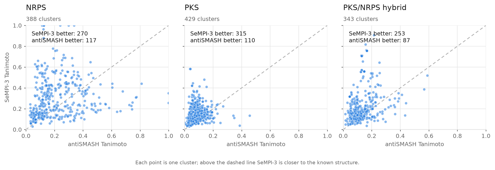
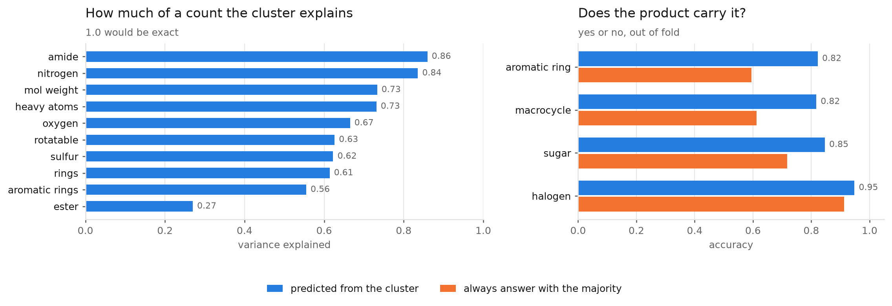
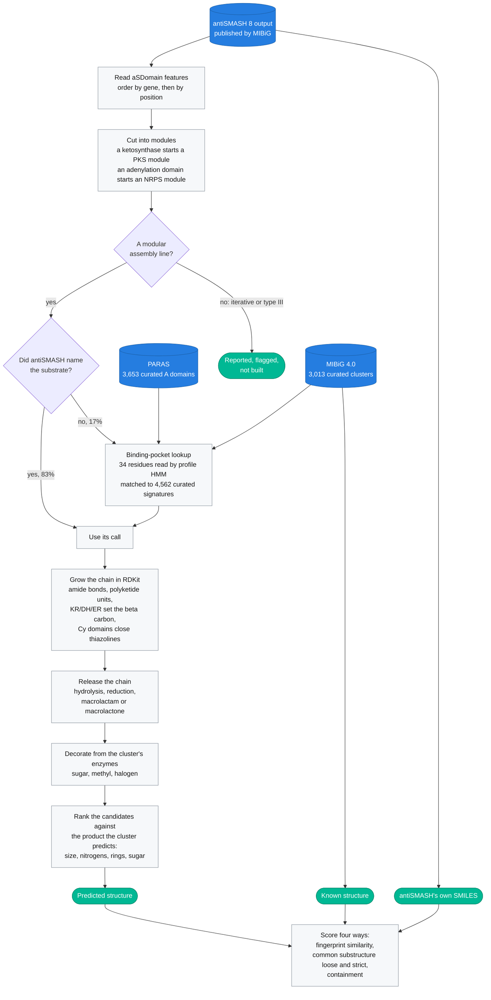

# SeMPI-3

Predict the structure of a secondary metabolite from its biosynthetic gene
cluster. SeMPI-3 reads an **antiSMASH** annotation, cuts the assembly line into
modules, and builds the product with **RDKit**.

Scope: modular type-I **PKS**, **NRPS** and their hybrids. Given the same
antiSMASH annotation, SeMPI-3 is closer to the real product than antiSMASH's
own prediction on **881 of 1,216 clusters** (mean Tanimoto 0.204 against
0.146 over everything, 0.214 over the clusters that are in scope, measured on
MIBiG 4.0).

## Install

```bash
git clone https://github.com/paulzierep/SeMPI-3.git
cd SeMPI-3
conda env create -f environment.yml
conda activate sempi3
pip install -e .
```

Nothing else is needed to predict: the binding-pocket table and the profile it
is read with ship inside the package. antiSMASH is **not** a dependency —
SeMPI-3 reads its *output*. HMMER is optional but recommended
(`conda install -c bioconda hmmer`); with `hmmalign` available the binding
pocket is read against a profile, which is more reliable on unusual domains.

## Run

Run antiSMASH however you normally do, then point SeMPI-3 at the GenBank file
it wrote. A genome-wide run holds many regions; each is predicted separately.

```bash
sempi3 run region001.gbk                     # report: structure, modules, antiSMASH's own call
sempi3 run region001.gbk --format tabular    # one row per region, for a workflow
sempi3 run region001.gbk --format smiles     # just the SMILES
sempi3 run region001.gbk --format json --out prediction.json
sempi3 run region001.gbk --no-tailoring      # the bare backbone, undecorated
```

What a report looks like:

```text
BGC0000290_region1  products=NRPS|T3PKS  modules=7
   0 nrps Dhpg
   1 nrps Tyr                        E        <- epimerase: a D residue
   2 nrps Hpg                        E
   ...
substrates named by the pocket model: 1
tailoring enzymes: {'halogenase': 2, 'hydroxylase': 4}
release: macrolactam
SeMPI-3:   O=C1N[C@@H](c2ccc(O)cc2Cl)C(=O)N[C@@H](c2cc(O)cc(O)c2)...
antiSMASH: NC(c1ccc(O)cc1)C(=O)NC(Cc1ccc(O)cc1)C(=O)NC(c1cc(O)cc(O)c1)...
```

The two predictions differ in ways worth reading: ours closes the macrolactam
(`O=C1N...N[C@H]1`), carries the chlorine the cluster's halogenases imply, and
keeps the stereochemistry the epimerase domains set. antiSMASH leaves the
chain linear, flat and undecorated.

A cluster whose product does not come off an assembly line — an iterative or
type III synthase — is flagged rather than mispredicted.

## Update

Everything the tool ships with is derived from public data, so a new release
of MIBiG or PARAS is absorbed by rebuilding rather than retraining:

```bash
./scripts/fetch_data.sh        # ~95 MB download, ~400 MB on disk
sempi3 build-reference         # rebuild the binding-pocket table
sempi3 train                   # rebuild the table the ranking models fit from
pytest -q && sempi3 benchmark  # check nothing regressed
```

There are no model files. The one fitted component is trained from a packaged
table the first time it is needed, so nothing is pinned to a scikit-learn
version.

## Results

<!-- RESULTS:START -->
Benchmark set: **1628 clusters** (MIBiG 4.0 PKS/NRPS entries with a known structure).

| Arm | Predicted | Tanimoto mean | Tanimoto median | ≥0.4 | ≥0.6 | Coverage of prediction |
|---|---|---|---|---|---|---|
| antiSMASH (baseline) | 1218 | 0.146 | 0.111 | 56 | 14 | 0.425 |
| SeMPI-3 from antiSMASH | 1406 | 0.204 | 0.154 | 159 | 42 | 0.532 |
| SeMPI-3 from MIBiG modules | 578 | 0.270 | 0.197 | 131 | 43 | 0.584 |

**Head to head against antiSMASH**, on clusters where both made a prediction:

| Arm | Compared | Wins | Ties | Losses | Mean Tanimoto difference |
|---|---|---|---|---|---|
| SeMPI-3 from antiSMASH | 1216 | 881 | 8 | 327 | +0.073 |
| SeMPI-3 from MIBiG modules | 536 | 375 | 4 | 157 | +0.095 |

**Mean Tanimoto by cluster class:**

| Class | Clusters | antiSMASH | SeMPI-3 (antiSMASH input) | SeMPI-3 (MIBiG modules) |
|---|---|---|---|---|
| NRPS_only | 469 | 0.219 | 0.301 | 0.339 |
| PKS_only | 677 | 0.091 | 0.139 | 0.139 |
| hybrid | 375 | 0.136 | 0.217 | 0.233 |
<!-- RESULTS:END -->







Scores are low in absolute terms for every tool here, because all of them
predict a *backbone* while the reference is the finished, tailored natural
product. The comparison between them is the meaningful part.

---

## Data

Only needed to rebuild the packaged tables or to run the benchmark; predicting
needs none of it.

| File | Size | What it gives |
|---|---|---|
| `mibig_json_4.0.tar.gz` | 30 MB | curated clusters: compounds with SMILES, curated modules |
| `mibig_antismash_4.0_gbk_as8b1.tar.bz2` | 64 MB | antiSMASH 8 output per entry: domains, substrates, baseline SMILES |
| PARAS database files | 300 kB | 3,653 curated A-domain substrates with binding-pocket signatures ([PARAS](https://github.com/BTheDragonMaster/parasect), CC BY 4.0) |

One more source, fetched by hand because the publisher blocks automated
requests, and **not** used by the shipped tool — adding it made substrate
prediction worse (0.638 to 0.619), which is recorded below:
`A_domains.csv` from the [SeMPI 2.0 supplement](https://www.mdpi.com/2218-1989/11/1/13/s1)
(Zierep et al., *Metabolites* 2020, CC BY). It lists 2,868 A domains, 1,546 of
them from Prieto et al. and keyed by UniProt accession rather than by cluster.
Put it in `data/external/sempi2/` and run:

```bash
python scripts/build_prieto_dataset.py --csv data/external/sempi2/A_domains.csv
```

That fetches the proteins from UniProt, locates each adenylation domain by
aligning the reference domain along the protein, and writes binding-pocket
signatures that `scripts/experiment_substrates.py` can train on.

Of 3,013 MIBiG entries, **1,457** are PKS/NRPS with both a known structure and
an antiSMASH annotation. That is the benchmark set.

## How it works



The numbered walk-through:

1. **Parse** (`antismash_io.py`) — read `aSDomain` features from the antiSMASH
   GenBank, order them by gene and position in the protein, and cut them into
   modules: a new PKS module at every ketosynthase, a new NRPS module at every
   adenylation domain. Substrates come from the `substrate consensus`
   qualifier, loading domains from their own call. A cluster whose product
   does not come off an assembly line at all — an iterative or type III
   synthase — is flagged rather than built, because its module count says
   nothing about the size of its product.
2. **Assemble** (`assembly.py`, `chem.py`) — grow the chain as a real molecule:
   - NRPS modules form an amide bond with their amino acid;
   - heterocyclisation (Cy) domains close the residue into a thiazoline
     (cysteine) or oxazoline (serine, threonine) ring;
   - PKS modules add a two-carbon unit, and the module's KR/DH/ER domains set
     the oxidation level of the beta carbon (keto → hydroxyl → ene → alkyl);
   - epimerase domains invert the alpha carbon, methyltransferases add a methyl;
   - the chain is released by hydrolysis, reduction, macrolactamisation or
     macrolactonisation.
   Tailoring enzymes found in the cluster then decorate the backbone
   (`tailoring.py`): a sugar, a halogen or a methyl group, one each at most.
3. **Fill the gaps** (`hmm_align.py`, `predictor.py`) — antiSMASH reports no
   substrate for about one adenylation domain in six. Those domains are given
   one by reading their 34 binding-pocket residues — against a profile HMM
   where HMMER is available, otherwise by pairwise alignment — and matching
   them to 4,562 curated signatures from MIBiG and PARAS. antiSMASH's own
   calls are never overridden.
4. **Choose** (`ranking.py`) — several structures can be built from one
   cluster. Rather than picking by rule, the cluster is asked what its product
   should look like, and the candidate closest to that description is kept.
5. **Compare** (`compare.py`) — score the prediction against the known
   structure four ways, because no single number says whether a backbone is
   right:

   | Measure | What it answers |
   |---|---|
   | `tanimoto` | Morgan-fingerprint similarity to the whole product |
   | `coverage_pred` | share of the prediction found in the product, bond orders ignored |
   | `strict_coverage_pred` | the same with bond orders required to agree |
   | `substructure` | is the prediction literally contained in the product |

   The strict measure exists because the loose one is blind to exactly the
   differences an assembly line decides. A saturated chain scored against an
   unsaturated one gives a loose coverage of 1.00 and a strict coverage of
   0.75; Tanimoto meanwhile falls from 1.0 to 0.375, which overstates a
   one-bond difference. Reading all four together is more honest than
   trusting any one of them.

The result is a **backbone**. Post-assembly tailoring — glycosylation,
halogenation, oxidative crosslinking, prenylation — is not modelled, so a
prediction is deliberately smaller than the finished natural product. The
`coverage_pred` metric is the one that should be high for a backbone
predictor: it asks whether everything predicted is really present in the
product.

## Evaluation design

Three arms are scored against the same ground truth, one row per cluster in
`results/benchmark.csv`:

| Arm | Input | What it measures |
|---|---|---|
| `antismash` | — | antiSMASH's own prediction: the baseline |
| `sempi3_antismash` | antiSMASH domains | **the fair comparison**: same information, different rules |
| `sempi3_mibig` | MIBiG curated modules | upper bound on the assembly chemistry |

Two caveats, stated plainly:

- **`sempi3_mibig` is not de-novo prediction.** MIBiG's curated substrates are
  partly inferred from the known structure, so that arm leaks information. It
  is reported to separate "the assembly rules are wrong" from "the substrate
  predictions are wrong", not as a headline number.
- **Every arm commits to one structure per cluster.** SeMPI-3 picks its release
  mechanism from the domains (`assembly.choose_release`) rather than reporting
  whichever variant happens to score best. The `sempi3_antismash_oracle` arm
  *does* take the best variant, and is reported only as an upper bound: it
  measures what perfect release prediction would be worth (+0.034 mean
  Tanimoto). A cluster often makes several congeners, so the best-matching
  compound is still taken for every arm alike; the chosen compound is recorded
  in the results table.

## What was tried, and what it was worth

Every change was measured on the full benchmark before being kept. Mean
Tanimoto of the committed prediction, in the order the work happened:

| Step | Mean | Kept |
|---|---|---|
| Backbone from antiSMASH domains | 0.187 | — |
| \+ substrate prediction for unassigned A domains | 0.192 | yes |
| \+ heterocyclisation from Cy domains | 0.192 | yes |
| \+ tailoring (sugar, methyl, halogen) | **0.195** | yes |
| Release mechanism from a structure-trained model | 0.186 | **no** |
| Release mechanism from a best-variant model | 0.189 | **no** |
| \+ hydroxylation from P450 genes | 0.188 | **no** |

### Ring sizes, and what the gene layout gives away

Macrolactones were closing onto whichever hydroxyl sat nearest the acid, which
is the smallest ring the chain allows. Real ones are much larger:

| | median macrocycle | 10-90 percentile |
|---|---|---|
| MIBiG products | 17 | 12-29 |
| closing onto the nearest hydroxyl | 10 | 8-17 |
| **closing onto the furthest** | **18** | 9-32 |

Closing onto the furthest hydroxyl lifted the mean Tanimoto from 0.195 to
0.200 and the strict structure match from 0.434 to 0.460, and it succeeds more
often, since very small rings frequently failed to sanitise at all.

Whether a product is macrocyclic at all can be predicted from the cluster:
0.819 against 0.613 for always answering no. The informative features are the
expected ones — module count, thioesterase domains — but also how the genes
are laid out: genes per kilobase, the median gap between them, the share of
genes in an operon, and how often the strand changes. Using that prediction in
place of the domain rule cut the losses against antiSMASH from 320 to 279.

More broadly, a cluster says a good deal about its product without any
chemistry being built at all:

| Property | Score | Baseline | Typical error |
|---|---|---|---|
| amide count | R² 0.86 | — | 0.7 |
| nitrogen count | R² 0.84 | — | 1.0 |
| molecular weight | R² 0.73 | — | 126 Da of 655 |
| heavy atoms | R² 0.73 | — | 9 of 46 |
| ring count | R² 0.61 | — | 1.1 |
| carries a sugar | 0.85 | 0.72 | — |
| carries an aromatic ring | 0.82 | 0.59 | — |
| is macrocyclic | 0.82 | 0.61 | — |

### What actually limits the prediction

Taking our own module parse and replacing only the substrates with MIBiG's
curated ones, over the 474 clusters that have both:

| Assembly line | Mean Tanimoto |
|---|---|
| our modules, antiSMASH substrates | 0.251 |
| our modules, **curated substrates** | **0.282** |
| fully curated modules | 0.280 |

Correct substrates recover the whole gap: our reading of the assembly line is
already as good as the curation, and every remaining point is in *which
monomer each module selects*. That one result explains why so much else made
no difference, and it is where the work should go.

Four learned models were trained and then left out, because each improved the
chemistry without improving the structures:

| Model | Its own accuracy | Effect on structures |
|---|---|---|
| Release mechanism, trained on structures | 0.753 against the rule's 0.284 | 0.186, worse than 0.192 |
| Release mechanism, trained on best variant | 0.535 | 0.189, worse |
| Beta-carbon oxidation state | 0.73 against the rule's 0.62 | unchanged, with 23 of 40 structures altered |
| Which detected modules to skip | 0.777, below always-keep's 0.807 | unchanged |

The oxidation-state model was checked three ways in case the measure was
hiding its gain: against the whole product (0.2102 either way), against the
product with its sugars and halogens stripped off (0.2071 against 0.2069),
and against a strict maximum common substructure where bond orders have to
agree and an oxidation level therefore counts (0.4229 against 0.4212). It
gained nothing on any of them. One oxygen among sixty atoms does not move a
structure comparison, while the monomer a module picks moves several atoms at
once.

One caveat on that: modules are aligned to the curation by gene and by order
within the gene, which can mismatch where the two disagree about how many
modules a gene carries. That would blur both the training labels and where
the predictions land, so the result is evidence against the oxidation state
mattering much, not proof.

Two results are worth stating plainly because they are negative:

- **A better release model made the structures worse.** A random forest picks
  the real release mechanism far better than the domain rule (0.753 against
  0.284 accuracy), yet the predictions got worse. Closing a macrocycle raises
  fingerprint similarity even when the real product has no macrocycle, so the
  cruder rule suits the metric better. The rule is still in place, and both
  models are kept in `scripts/` rather than deleted.
- **Tailoring barely helps, and hydroxylation hurts.** The annotation says
  *which* enzyme a cluster encodes but never *where* it acts, so the site has
  to be guessed. Guessing costs more than it gains for hydroxyls.
- **Copying the nearest cluster is not prediction.** Encoding every cluster as
  a vector (`features.py`) and reporting the structure of its closest
  neighbour scores 0.323, which looks better than anything here — until
  neighbours above 0.9 similarity are excluded, when it falls to 0.161, below
  the assembled prediction. MIBiG holds near-duplicate clusters, and retrieval
  lives off them. For comparison, an assembled prediction sits 0.26 to 0.44
  away from the nearest known structure: it is built, not recalled.

### Substrate prediction

antiSMASH leaves about one adenylation domain in six without a call. Those
domains get one from their binding-pocket residues, matched against curated
domains from MIBiG and [PARAS](https://github.com/BTheDragonMaster/parasect).
Over 2,680 labelled domains, in folds grouped by cluster:

| Predictor | Accuracy |
|---|---|
| antiSMASH alone | 0.665 (no call for 415 domains) |
| Stachelhaus 9-residue code, MIBiG only | 0.590 |
| 34-residue signature, MIBiG only | 0.555 |
| 34-residue signature, MIBiG + PARAS | 0.606 |
| Random forest, MIBiG + PARAS | 0.638 |
| **antiSMASH, with the pocket model filling its gaps** | **0.715** |

The model does not beat antiSMASH on its own; it is worth having because it
answers where antiSMASH does not. Adding the PARAS data helped every variant
it was given to.

The binding-pocket positions were not copied from a paper: they were recovered
from the PARAS dataset by alignment, and the reference sequence shipped in
`sempi3/data/` reproduces the published `DAWTIAAIC` code for phenylalanine,
which is what pins the numbering.

## Roadmap

Ordered by what the measurements say is worth doing, not by what is
interesting to build:

1. **Better substrates, and nothing else first.** Correct monomers are worth
   +0.031 on their own, more than everything else tried put together.
   antiSMASH is right 78.6% of the time when it commits, so the target is
   beating those calls rather than only filling the gaps.
2. **Where tailoring acts**, rather than only which enzymes are present. The
   annotation names the enzyme but never the site, and a guessed site is worth
   little: glycosylation gains 0.0015 and hydroxylation loses 0.0035.
3. **Learn from trans-AT.** Those clusters score best of any subtype (0.231
   against antiSMASH's 0.098), because antiSMASH's transATor call states the
   oxidation level outright. Nothing else gets that kind of evidence, and it
   is worth asking what would.
4. **Iterative synthases**, which are flagged and skipped today. Predicting
   how many times a module fires is a different problem from reading an
   assembly line, and 148 clusters in the benchmark need it.
5. **A generative block model worth the name.** `blocks.py` defines the token
   language and guarantees any sequence assembles; what is missing is a
   sequence model trained on honest splits, which wants a GPU and more data
   than MIBiG alone provides.

What is *not* worth doing, because it was tried and measured: extender-unit
prediction for polyketides (antiSMASH's calls are worth +0.007 over assuming
malonyl), release-mechanism models, module-skipping models, and copying the
nearest cluster's structure.

## Development

```bash
pytest -q                                      # 112 tests, no downloaded data needed
ruff check sempi3 tests && black --check sempi3 tests
```

The tests cover the chemistry primitives against independently written
reference SMILES and CIP codes, the assembly rules, both parsers, the
binding-pocket reader and the ranking models.

The experiments behind the claims in this README live in `scripts/`, each
runnable on its own and each writing its report to `results/`:

| Script | Question it answers |
|---|---|
| `experiment_substrates.py` | which substrate predictor is best, and does more data help |
| `experiment_release.py` | can the release mechanism be learned |
| `experiment_blocks.py` | can building blocks be generated from the cluster |
| `experiment_module_skip.py` | should any detected module be dropped |
| `experiment_structure_features.py` | what does a cluster reveal about its product |
| `experiment_rank.py` | does ranking candidates beat choosing by rule |
| `experiment_retrieval.py` | how much of a lookalike score is just near-duplicate clusters |
| `predict_substrate_fill.py` | out-of-fold substrate calls for the benchmark |

## Background

SeMPI-3 follows [SeMPI](https://academic.oup.com/nar/article/44/W1/W510/2499349)
and [SeMPI 2.0](https://doi.org/10.3390/metabo11010013), which predicted
PKS/NRPS products and screened them against natural-product databases.

It is built on data from other people's work:

* **MIBiG 4.0** — curated gene clusters and the structures they make.
* **antiSMASH 8** — the domain annotation every prediction starts from, and
  the baseline every result is measured against. MIBiG publishes its output
  for every entry, so antiSMASH itself is not a dependency.
* **PARAS/PARASECT** ([Terlouw et al.](https://www.biorxiv.org/content/10.1101/2025.01.08.631717v2.full),
  CC BY 4.0) — 3,653 curated adenylation-domain substrates, their binding-pocket
  signatures, structures for several hundred unusual monomers, and the Pfam
  AMP-binding profile used to read a pocket. Their data is used; their code,
  which is AGPL, is not.

## License

MIT — see [LICENSE](LICENSE).
