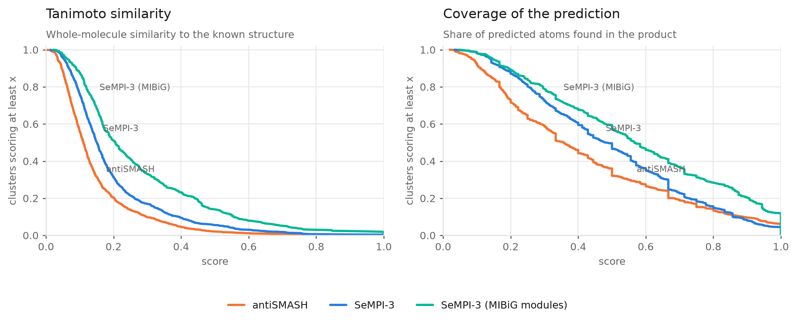
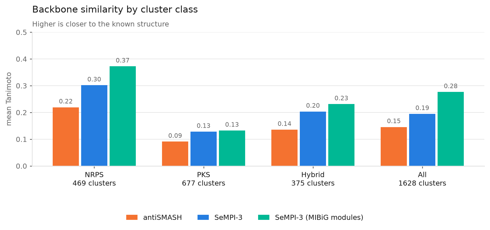

# SeMPI-3

Predict the chemical structure of a secondary metabolite from the composition
and order of the genes in its biosynthetic gene cluster (BGC).

SeMPI-3 reads an **antiSMASH** annotation, cuts the assembly line into modules,
and builds the product backbone atom by atom with **RDKit**. Predictions are
benchmarked against the curated structures in **MIBiG 4.0**, with antiSMASH's
own structure prediction as the baseline to beat.

Scope: modular type-I **PKS**, **NRPS** and PKS/NRPS hybrids — the systems whose
product can be read off the domain order.

> Status: early. The rule-based engine and the benchmark work end to end; the
> machine-learning stage is not built yet. See [Roadmap](#roadmap).

## Install

```bash
conda env create -f environment.yml
conda activate sempi3
pip install -e .
```

antiSMASH is **not** a dependency. SeMPI-3 reads antiSMASH *output*, and MIBiG
publishes that output for every entry, so nothing has to be installed or run.

## Data

```bash
./scripts/fetch_data.sh      # ~95 MB download, ~400 MB on disk
```

| File | Size | What it gives |
|---|---|---|
| `mibig_json_4.0.tar.gz` | 30 MB | curated clusters: compounds with SMILES, curated modules |
| `mibig_antismash_4.0_gbk_as8b1.tar.bz2` | 64 MB | antiSMASH 8 output per entry: domains, substrates, baseline SMILES |
| `dataset_paras.tsv` | 175 kB | 2,873 curated A-domain substrates with binding-pocket signatures ([PARAS](https://github.com/BTheDragonMaster/parasect), CC BY 4.0) |

Of 3,013 MIBiG entries, **1,457** are PKS/NRPS with both a known structure and
an antiSMASH annotation. That is the benchmark set.

## Use

```bash
sempi3 predict BGC0000290              # predict one cluster, show its modules
sempi3 predict BGC0000290 --show-variants
sempi3 spec BGC0000001                 # the parsed assembly line, as JSON
sempi3 benchmark --workers 8           # score every arm over MIBiG
```

## How it works

1. **Parse** (`antismash_io.py`) — read `aSDomain` features from the antiSMASH
   GenBank, order them by gene and position in the protein, and cut them into
   modules: a new PKS module at every ketosynthase, a new NRPS module at every
   adenylation domain. Substrates come from the `substrate consensus` qualifier.
2. **Assemble** (`assembly.py`, `chem.py`) — grow the chain as a real molecule:
   - NRPS modules form an amide bond with their amino acid;
   - heterocyclisation (Cy) domains close the residue into a thiazoline
     (cysteine) or oxazoline (serine, threonine) ring;
   - PKS modules add a two-carbon unit, and the module's KR/DH/ER domains set
     the oxidation level of the beta carbon (keto → hydroxyl → ene → alkyl);
   - epimerase domains invert the alpha carbon, methyltransferases add a methyl;
   - the chain is released by hydrolysis, reduction, macrolactamisation or
     macrolactonisation.
   Tailoring enzymes found in the cluster then decorate the backbone
   (`tailoring.py`): a sugar, a halogen or a methyl group, one each at most.
3. **Fill the gaps** (`stachelhaus.py`, `substrates.py`) — antiSMASH reports
   no substrate for about one adenylation domain in six. Those domains are
   given one by reading their binding-pocket residues and matching them
   against curated domains from MIBiG and PARAS. antiSMASH's own calls are
   never overridden.
4. **Compare** (`compare.py`) — score the prediction against the known
   structure with Morgan-fingerprint Tanimoto and a maximum-common-substructure
   search.

The result is a **backbone**. Post-assembly tailoring — glycosylation,
halogenation, oxidative crosslinking, prenylation — is not modelled, so a
prediction is deliberately smaller than the finished natural product. The
`coverage_pred` metric is the one that should be high for a backbone
predictor: it asks whether everything predicted is really present in the
product.

## Evaluation design

Three arms are scored against the same ground truth, one row per cluster in
`results/benchmark.csv`:

| Arm | Input | What it measures |
|---|---|---|
| `antismash` | — | antiSMASH's own prediction: the baseline |
| `sempi3_antismash` | antiSMASH domains | **the fair comparison**: same information, different rules |
| `sempi3_mibig` | MIBiG curated modules | upper bound on the assembly chemistry |

Two caveats, stated plainly:

- **`sempi3_mibig` is not de-novo prediction.** MIBiG's curated substrates are
  partly inferred from the known structure, so that arm leaks information. It
  is reported to separate "the assembly rules are wrong" from "the substrate
  predictions are wrong", not as a headline number.
- **Every arm commits to one structure per cluster.** SeMPI-3 picks its release
  mechanism from the domains (`assembly.choose_release`) rather than reporting
  whichever variant happens to score best. The `sempi3_antismash_oracle` arm
  *does* take the best variant, and is reported only as an upper bound: it
  measures what perfect release prediction would be worth (+0.034 mean
  Tanimoto). A cluster often makes several congeners, so the best-matching
  compound is still taken for every arm alike; the chosen compound is recorded
  in the results table.

## Results

Benchmark over the MIBiG 4.0 PKS/NRPS set. Numbers are regenerated by
`sempi3 benchmark`; the table below is filled in from `results/benchmark.summary.json`.






<!-- RESULTS:START -->
Benchmark set: **1628 clusters** (MIBiG 4.0 PKS/NRPS entries with a known structure).

| Arm | Predicted | Tanimoto mean | Tanimoto median | ≥0.4 | ≥0.6 | Coverage of prediction |
|---|---|---|---|---|---|---|
| antiSMASH (baseline) | 1218 | 0.146 | 0.111 | 56 | 14 | 0.425 |
| SeMPI-3 from antiSMASH | 1341 | 0.195 | 0.150 | 127 | 40 | 0.500 |
| SeMPI-3 from MIBiG modules | 528 | 0.276 | 0.205 | 122 | 41 | 0.579 |

**Head to head against antiSMASH**, on clusters where both made a prediction:

| Arm | Compared | Wins | Ties | Losses | Mean Tanimoto difference |
|---|---|---|---|---|---|
| SeMPI-3 from antiSMASH | 1161 | 864 | 7 | 290 | +0.062 |
| SeMPI-3 from MIBiG modules | 490 | 360 | 5 | 125 | +0.098 |

**Mean Tanimoto by cluster class:**

| Class | Clusters | antiSMASH | SeMPI-3 (antiSMASH input) | SeMPI-3 (MIBiG modules) |
|---|---|---|---|---|
| NRPS_only | 469 | 0.219 | 0.302 | 0.372 |
| PKS_only | 677 | 0.091 | 0.128 | 0.132 |
| hybrid | 375 | 0.136 | 0.203 | 0.231 |

Tanimoto is low for every arm in absolute terms, which is expected: all three predict a *backbone*, while the reference is the finished, tailored natural product. The comparison between arms is the meaningful part.
<!-- RESULTS:END -->

## What was tried, and what it was worth

Every change was measured on the full benchmark before being kept. Mean
Tanimoto of the committed prediction, in the order the work happened:

| Step | Mean | Kept |
|---|---|---|
| Backbone from antiSMASH domains | 0.187 | — |
| \+ substrate prediction for unassigned A domains | 0.192 | yes |
| \+ heterocyclisation from Cy domains | 0.192 | yes |
| \+ tailoring (sugar, methyl, halogen) | **0.195** | yes |
| Release mechanism from a structure-trained model | 0.186 | **no** |
| Release mechanism from a best-variant model | 0.189 | **no** |
| \+ hydroxylation from P450 genes | 0.188 | **no** |

Two results are worth stating plainly because they are negative:

- **A better release model made the structures worse.** A random forest picks
  the real release mechanism far better than the domain rule (0.753 against
  0.284 accuracy), yet the predictions got worse. Closing a macrocycle raises
  fingerprint similarity even when the real product has no macrocycle, so the
  cruder rule suits the metric better. The rule is still in place, and both
  models are kept in `scripts/` rather than deleted.
- **Tailoring barely helps, and hydroxylation hurts.** The annotation says
  *which* enzyme a cluster encodes but never *where* it acts, so the site has
  to be guessed. Guessing costs more than it gains for hydroxyls.

### Substrate prediction

antiSMASH leaves about one adenylation domain in six without a call. Those
domains get one from their binding-pocket residues, matched against curated
domains from MIBiG and [PARAS](https://github.com/BTheDragonMaster/parasect).
Over 2,680 labelled domains, in folds grouped by cluster:

| Predictor | Accuracy |
|---|---|
| antiSMASH alone | 0.665 (no call for 415 domains) |
| Stachelhaus 9-residue code, MIBiG only | 0.590 |
| 34-residue signature, MIBiG only | 0.555 |
| 34-residue signature, MIBiG + PARAS | 0.606 |
| Random forest, MIBiG + PARAS | 0.638 |
| **antiSMASH, with the pocket model filling its gaps** | **0.715** |

The model does not beat antiSMASH on its own; it is worth having because it
answers where antiSMASH does not. Adding the PARAS data helped every variant
it was given to.

The binding-pocket positions were not copied from a paper: they were recovered
from the PARAS dataset by alignment, and the reference sequence shipped in
`sempi3/data/` reproduces the published `DAWTIAAIC` code for phenylalanine,
which is what pins the numbering.

## Roadmap

1. **Rule-based backbone with pocket-model substrates** — done, benchmarked above.
2. **PKS is the weak class** (0.128 against antiSMASH's 0.091, while NRPS is
   0.302 against 0.219): trans-AT handling, beta-branching, starter units
   beyond acetyl, and KR stereochemistry.
3. **Where tailoring acts**, rather than only which enzymes are present. This
   is where most of the remaining difference to the true structure sits.
4. **Retrieval baseline** — transfer the structure of the most similar known
   cluster, as a sanity check that any learned model beats simple lookup.

## Development

```bash
pytest -q                                  # unit tests, no data needed
ruff check sempi3 tests && black --check sempi3 tests
```

Tests cover the chemistry primitives against independently written reference
SMILES and CIP codes, the assembly rules, and both parsers.

## Background

SeMPI-3 follows [SeMPI](https://academic.oup.com/nar/article/44/W1/W510/2499349)
and SeMPI 2.0, which predicted PKS/NRPS products and screened them against
natural-product databases.

## License

MIT — see [LICENSE](LICENSE).
