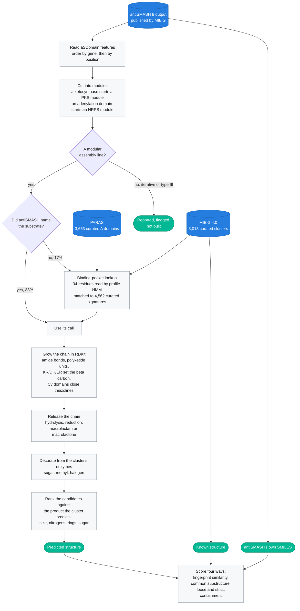

# How SeMPI-3 works

[← back to the README](../README.md)

## How it works

The numbered walk-through:

1. **Parse** (`antismash_io.py`) — read `aSDomain` features from the antiSMASH
   GenBank, order them by gene and position in the protein, and cut them into
   modules: a new PKS module at every ketosynthase, a new NRPS module at every
   adenylation domain. Substrates come from the `substrate consensus`
   qualifier, loading domains from their own call. A cluster whose product
   does not come off an assembly line at all — an iterative or type III
   synthase — is flagged rather than built, because its module count says
   nothing about the size of its product.
2. **Assemble** (`assembly.py`, `chem.py`) — grow the chain as a real molecule:
   - NRPS modules form an amide bond with their amino acid;
   - heterocyclisation (Cy) domains close the residue into a thiazoline
     (cysteine) or oxazoline (serine, threonine) ring;
   - PKS modules add a two-carbon unit, and the module's KR/DH/ER domains set
     the oxidation level of the beta carbon (keto → hydroxyl → ene → alkyl);
   - epimerase domains invert the alpha carbon, methyltransferases add a methyl;
   - the chain is released by hydrolysis, reduction, macrolactamisation or
     macrolactonisation.
   Tailoring enzymes found in the cluster then decorate the backbone
   (`tailoring.py`): a sugar, a halogen or a methyl group, one each at most.
3. **Fill the gaps** (`hmm_align.py`, `predictor.py`) — antiSMASH reports no
   substrate for about one adenylation domain in six. Those domains are given
   one by reading their 34 binding-pocket residues — against a profile HMM
   where HMMER is available, otherwise by pairwise alignment — and matching
   them to 4,562 curated signatures from MIBiG and PARAS. antiSMASH's own
   calls are never overridden.
4. **Choose** (`ranking.py`) — several structures can be built from one
   cluster. Rather than picking by rule, the cluster is asked what its product
   should look like, and the candidate closest to that description is kept.
5. **Compare** (`compare.py`) — score the prediction against the known
   structure four ways, because no single number says whether a backbone is
   right:

   | Measure | What it answers |
   |---|---|
   | `tanimoto` | Morgan-fingerprint similarity to the whole product |
   | `coverage_pred` | share of the prediction found in the product, bond orders ignored |
   | `strict_coverage_pred` | the same with bond orders required to agree |
   | `substructure` | is the prediction literally contained in the product |

   The strict measure exists because the loose one is blind to exactly the
   differences an assembly line decides. A saturated chain scored against an
   unsaturated one gives a loose coverage of 1.00 and a strict coverage of
   0.75; Tanimoto meanwhile falls from 1.0 to 0.375, which overstates a
   one-bond difference. Reading all four together is more honest than
   trusting any one of them.

The result is a **backbone**. Post-assembly tailoring — glycosylation,
halogenation, oxidative crosslinking, prenylation — is not modelled, so a
prediction is deliberately smaller than the finished natural product. The
`coverage_pred` metric is the one that should be high for a backbone
predictor: it asks whether everything predicted is really present in the
product.

## Background

SeMPI-3 follows [SeMPI](https://academic.oup.com/nar/article/44/W1/W510/2499349)
and [SeMPI 2.0](https://doi.org/10.3390/metabo11010013), which predicted
PKS/NRPS products and screened them against natural-product databases.

It is built on data from other people's work:

* **MIBiG 4.0** — curated gene clusters and the structures they make.
* **antiSMASH 8** — the domain annotation every prediction starts from, and
  the baseline every result is measured against. MIBiG publishes its output
  for every entry, so antiSMASH itself is not a dependency.
* **PARAS/PARASECT** ([Terlouw et al.](https://www.biorxiv.org/content/10.1101/2025.01.08.631717v2.full),
  CC BY 4.0) — 3,653 curated adenylation-domain substrates, their binding-pocket
  signatures, structures for several hundred unusual monomers, and the Pfam
  AMP-binding profile used to read a pocket. Their data is used; their code,
  which is AGPL, is not.
